<div align="center">

<picture>
  <source media="(prefers-color-scheme: dark)" srcset="assets/logo-dark.svg">
  
</picture>

<p><strong>Agents propose. A human approves the exact bytes. It happens once.</strong></p>

[](https://github.com/MohamedBenTaher/tierbound/actions/workflows/ci.yml) [](https://github.com/MohamedBenTaher/tierbound/actions/workflows/consent-pages.yml) [](worker/go.mod) [](https://supabase.com) [](LICENSE)

</div>

---

tierbound is a small, Supabase-native agent runner that keeps **deciding**
apart from **doing**. An agent can only *propose* an outside action (today, a
triage comment on a GitHub issue). You read the exact comment in Cursor and
approve it over a remote MCP server; the approval is bound to a hash of that
content. A separate Edge Function, the only piece holding a GitHub write
credential, then posts it **exactly once**.

It runs end to end on a hosted Supabase project: issue → webhook → queue → Go
worker → proposed comment → approval from Cursor (OAuth 2.1, GitHub sign-in)
→ one bot comment.

## How it flows

1. **Ingest:** a GitHub webhook lands in an Edge Function, which dedupes it by delivery id and queues a job (pgmq).
2. **Propose:** the Go worker reads the issue with a read-only token, drafts a comment with an LLM, and stores it as a *proposed action* with its `payload_hash`.
3. **Review:** in Cursor, `list_pending_actions` / `get_action` show the exact text, target and hash.
4. **Approve:** `approve_action(hash)` decides in one locked transaction. A changed proposal no longer matches the hash.
5. **Effect:** a trigger calls the effector, which claims the action once, re-checks the hash, and posts a single comment carrying a hidden marker.

## Guarantees

Agents that can write to the outside world tend to fail in two ways: they say
something nobody approved, or they say it twice. tierbound makes both
structurally impossible rather than unlikely, and each guarantee has a test:

| Guarantee | How | Proven by |
| --- | --- | --- |
| The worker never holds a write credential | worker role can insert `runs` / `proposed_actions` only; read-only GitHub token | `TestWorkerRoleDeniedOnApprovalsAndEffects`, `TestWorkerLoginCannotCommitEffects` |
| An approval covers exactly what is posted, where, and what kind | `payload_hash` = sha256 of canonical `{kind, target, payload}`, recomputed at approve (SQL) and at effect (TS); Go/TS/SQL pinned by shared vectors | `TestTamperThenApproveWithOldHashRefused`, `TestRetargetAfterApprovalRefusedByEffector`, `TestSQLActionHashMatchesGoldenVectors` |
| One decision per action, no owner edits | `tierbound_decide_action`: one locked transaction; owners have no write grants | `TestConcurrentApproveAndRejectYieldOneDecision`, `TestOwnerCannotEditActionsOrWriteApprovals` |
| Executed at most once, even under retries, crashes, timeouts | unique claim, lease + fenced takeover, `<!-- tierbound:<id> -->` marker search before posting; checked with a TLA+ model | `TestConcurrentInvocationsPostOnce`, `TestTimeoutAfterSuccessRetryDoesNotDoublePost`, `TestCrashBetweenPostAndRecord`, `TestInjectedGitHub500ThenRetryPostsOnce` |
| Only an evaluated config can propose | `config_hash` of prompt+model+grant+tier must equal the registered hash and `evals_passed_hash`; CI eval gate replays recorded outputs per hash | `TestActivationRule`, `eval-gate` CI job |

## Architecture

```mermaid
flowchart LR
  GH["GitHub issue opened"] -- "webhook (HMAC)" --> ING["Edge Function: ingest"]
  ING -- "dedupe by delivery id" --> Q[("pgmq: jobs")]
  Q --> W["Go worker (read-only token)"]
  W -- "draft via LLM" --> PA[("proposed_actions + payload_hash")]
  CUR["Cursor (MCP client)"] -- "OAuth 2.1" --> MCP["Edge Function: mcp"]
  PA -. "list / get (RLS: owner)" .-> MCP
  MCP -- "approve(hash)" --> DEC["tierbound_decide_action (locked txn)"]
  DEC --> AP[("approvals")]
  AP -- "trigger + pg_net" --> EFF["Edge Function: effect-github-comment"]
  EFF -- "claim once, recheck hash" --> EF[("effects")]
  EFF -- "GitHub App token" --> CM["one bot comment with marker"]
```



Everything stateful lives in Postgres (Supabase): pgmq for the queue, RLS per
owner, Vault for the webhook wiring, and Supabase Auth as the OAuth 2.1 server
for MCP. There is no dashboard; MCP is the UI, plus a one-page
[consent screen](https://mohamedbentaher.github.io/tierbound/oauth/consent/)
on GitHub Pages.

## See it run

https://github.com/user-attachments/assets/5318bc89-0223-430d-83ef-e0559691d8e8

- **Real run:** on the dogfood repo, [issue #1](https://github.com/MohamedBenTaher/tierbound/issues/1) got exactly one comment, 1.9 s after the approval in Cursor.
- **Eval gate:** [PR #2](https://github.com/MohamedBenTaher/tierbound/pull/2) deliberately ships a worse prompt, and the `eval-gate` check fails it.
- **Demo:** the 47-second video above, recorded on [issue #4](https://github.com/MohamedBenTaher/tierbound/issues/4) ([shot list](docs/demo-script.md)).

## Run it

- **Local:** `supabase start && supabase db reset`, then `scripts/test-effector.sh` runs the end-to-end suite against a fake GitHub. Worker: `cd worker && go test ./... && go run ./cmd/worker`.
- **Hosted:** [runbooks/hosted-setup.md](runbooks/hosted-setup.md) covers linking, pushing, secrets, deploying, the GitHub App, and approving from Cursor.
- **Evals:** `cd worker && go run ./cmd/evalscore ../evals/golden` replays the recording for the current `config_hash`; `-record` re-drafts with the model. See [evals/README.md](evals/README.md).

## Docs

- [SPEC.md](docs/SPEC.md): motivation, scope, data model, architecture
- [IMPLEMENTATION_PLAN.md](docs/IMPLEMENTATION_PLAN.md): weekend-by-weekend steps with done-when checks
- [postmortem-001](docs/postmortems/postmortem-001.md): injected GitHub 500 after claim
- Runbooks: [hosted setup](runbooks/hosted-setup.md), [effect stuck](runbooks/effect-stuck.md), [retry after crash](runbooks/retry-after-crash.md)
- [AGENTS.md](AGENTS.md): how coding agents work in this repo

## Layout

```
supabase/          migrations + Edge Functions (ingest, mcp, effect-github-comment)
worker/            Go pgmq consumer, eval runner (cmd/evalscore)
evals/             golden issues, rubric, recordings per config_hash, gate
consent/           OAuth consent page, published to GitHub Pages
assets/            logo and favicon
docs/postmortems/  incident writeups
runbooks/          operator runbooks
```

## License

MIT © Mohamed Ben Taher
