# tierbound

A Supabase-native agent runner that separates **deciding** from **doing**. An
agent can only *propose* an outside action (a GitHub triage comment). A human
approves the exact content, bound by hash, from Cursor over a remote MCP
server. A separate Edge Function that alone holds the GitHub credential then
executes it **exactly once**.

**Status:** v1 running end to end on a hosted Supabase project (2026-11-12):
issue → webhook → queue → Go worker → proposed comment → approval from Cursor
(OAuth 2.1) → one bot comment. Weekend 3 (evals, activation rule, postmortem)
done; demo video pending.

## Why

Agents that can write to the outside world fail in two ways: they say
something nobody approved, or they do it twice. tierbound makes both
structurally impossible rather than unlikely:

| Guarantee | How | Proven by |
| --- | --- | --- |
| The worker never holds a write credential | worker role can insert `runs` / `proposed_actions` only; read-only GitHub token | `TestWorkerRoleDeniedOnApprovalsAndEffects`, `TestWorkerLoginCannotCommitEffects` |
| An approval covers exactly what is posted, where, and what kind | `payload_hash` = sha256 of canonical `{kind, target, payload}`, recomputed at approve (SQL) and at effect (TS); Go/TS/SQL pinned by shared vectors | `TestTamperThenApproveWithOldHashRefused`, `TestRetargetAfterApprovalRefusedByEffector`, `TestSQLActionHashMatchesGoldenVectors` |
| One decision per action, no owner edits | `tierbound_decide_action`: one locked transaction; owners have no write grants | `TestConcurrentApproveAndRejectYieldOneDecision`, `TestOwnerCannotEditActionsOrWriteApprovals` |
| Executed at most once, even under retries, crashes, timeouts | unique claim, lease + fenced takeover, `<!-- tierbound:<id> -->` marker search before posting; checked with a TLA+ model | `TestConcurrentInvocationsPostOnce`, `TestTimeoutAfterSuccessRetryDoesNotDoublePost`, `TestCrashBetweenPostAndRecord`, `TestInjectedGitHub500ThenRetryPostsOnce` |
| Only an evaluated config can propose | `config_hash` of prompt+model+grant+tier must equal the registered hash and `evals_passed_hash`; CI eval gate replays recorded outputs per hash | `TestActivationRule`, `eval-gate` CI job |

## Architecture

```mermaid
flowchart LR
  GH["GitHub issue opened"] -- "webhook (HMAC)" --> ING["Edge Function: ingest"]
  ING -- "dedupe by delivery id" --> Q[("pgmq: jobs")]
  Q --> W["Go worker (read-only token)"]
  W -- "draft via LLM" --> PA[("proposed_actions + payload_hash")]
  CUR["Cursor (MCP client)"] -- "OAuth 2.1" --> MCP["Edge Function: mcp"]
  PA -. "list / get (RLS: owner)" .-> MCP
  MCP -- "approve(hash)" --> DEC["tierbound_decide_action (locked txn)"]
  DEC --> AP[("approvals")]
  AP -- "trigger + pg_net" --> EFF["Edge Function: effect-github-comment"]
  EFF -- "claim once, recheck hash" --> EF[("effects")]
  EFF -- "GitHub App token" --> CM["one bot comment with marker"]
```



Everything stateful is Postgres (Supabase): pgmq for the queue, RLS per owner,
Vault for the webhook wiring, Supabase Auth as the OAuth 2.1 server for MCP.
There is no web dashboard: MCP is the UI.

## Demo

45-second script: [SPEC section 8](docs/SPEC.md). Video: *pending*.

Real run on the dogfood repo: [issue #1](https://github.com/MohamedBenTaher/tierbound/issues/1)
got exactly one comment, 1.9 s after the approval in Cursor.

## Run it

- **Local:** `supabase start && supabase db reset`, then
  `scripts/test-effector.sh` runs the end-to-end suite against a fake GitHub
  (17 tests). Worker: `cd worker && go test ./... && go run ./cmd/worker`.
- **Hosted:** [runbooks/hosted-setup.md](runbooks/hosted-setup.md) (link, push,
  secrets, deploy, GitHub App, approving from Cursor).
- **Evals:** `cd worker && go run ./cmd/evalscore ../evals/golden` replays the
  recording for the current `config_hash`; `-record` re-drafts with the model.
  See [evals/README.md](evals/README.md).

## Docs

- [SPEC.md](docs/SPEC.md) — motivation, scope, data model, architecture
- [IMPLEMENTATION_PLAN.md](docs/IMPLEMENTATION_PLAN.md) — weekend-by-weekend steps with done-when checks
- [postmortem-001](docs/postmortems/postmortem-001.md) — injected GitHub 500 after claim
- Runbooks: [hosted setup](runbooks/hosted-setup.md), [effect stuck](runbooks/effect-stuck.md), [retry after crash](runbooks/retry-after-crash.md)
- [AGENTS.md](AGENTS.md) — how coding agents work in this repo

## Layout

```
supabase/          migrations + Edge Functions (ingest, mcp, effect-github-comment)
worker/            Go pgmq consumer, eval runner (cmd/evalscore)
evals/             golden issues, rubric, recordings per config_hash, gate
consent/           OAuth consent page (throwaway; no product UI)
docs/postmortems/  incident writeups
runbooks/          operator runbooks
```

## License

MIT © Mohamed Ben Taher
