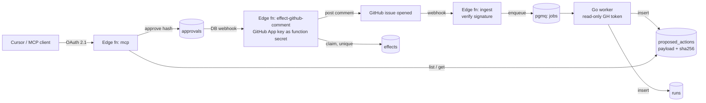

# tierbound — spec & build plan (v1)

> A Supabase-native runner where an agent can **propose** an outside action but never perform it. A human approves the **exact** content (by hash) over MCP, and a separate function holding the credential executes it **exactly once**.

---

## 1. Motivation

**Target roles:** Supabase *AI Platform Engineer* and *Software Engineer – AI Tooling Infrastructure* (Remote, Global).

**What my public work already proves:**
- `citibench`: RAG, evals gating CI (RAGAS + redteam), Langfuse traces, MCP server
- `test-scale`: Go distributed load testing, K8s, OpenTelemetry
- `py-bridge`: typed contract generation (Pydantic → Zod)
- InnovX: production RAG, Azure IaC (Terraform/Helm/K8s)

**What the job descriptions ask for that is not visible yet:**
| JD asks for | tierbound answers with |
|---|---|
| Production agent systems with durable state | pgmq queue + run ledger + retries with visibility timeout |
| Human review gates | Hash-bound approvals over MCP |
| Least-privilege credentials, dangerous actions have no code path | Worker has no write credential; only the effector holds the GitHub key; RLS + roles |
| Evals that gate CI | Golden issue set; config can't go live until its hash passed evals |
| Authored MCP servers, OAuth/JWT API authorization | Remote MCP on Edge Functions behind Supabase Auth OAuth 2.1 |
| Incidents, on-call, observability | Injected failure + written postmortem + runbook |

**Why it's not a clone:** Supabase already has a hosted MCP server and generic MCP gateways exist. tierbound is not a gateway. Its point is **separating deciding from doing**: an agent's power is limited by database structure, not by `if` statements in app code.

**Not another chat surface:** no chat UI, no RAG. MCP (from Cursor) is the only UI.

---

## 2. Scope

### In v1
- One agent: `triage-drafter`
- One action type: `github_comment`
- One repo (my own)
- Two tiers: `read` (fetch issues only) and `draft` (propose; needs approval to take effect)
- Supabase: Postgres, RLS, Auth OAuth 2.1, Queues (pgmq), Edge Functions, Vault, DB webhooks
- Go worker
- GitHub Action eval gate
- One injected failure + postmortem
- README with architecture diagram + 45-second demo video

### Out of scope (v1)
BigQuery or any warehouse · web dashboard · multiple agents · multiple action types · Slack/email · auto-approve / auto-execute tier · commitment tier (exists only as a denial test) · generic tool registry · custom OAuth server · agent frameworks (LangGraph etc.) · multi-tenancy beyond owner-scoped RLS · Kubernetes.

### Later (stretch, after v1 ships)
- **v2 action kinds** (designed in [V2_ACTIONS.md](V2_ACTIONS.md), Phases 4–8 of the plan): `github_issue`, `github_pr_review` (`review-pr`), `github_report` (`review-repo`), `github_pr_fix` (draft PRs only), under tiers `draft` < `gate` < `code` with eval-earned capabilities
- Small GCP/BigQuery export of the run ledger (the AI Platform JD mentions a GCP warehouse)
- Supabase template (`supabase init`-style one command)
- Upstream issue/PR on Supabase's MCP server (e.g. tier-scoped tool grants)
- test-scale scenario: webhook storm against `ingest`

---

## 3. Use case (dogfood)

When an issue is opened on my repo, `triage-drafter` drafts **one** comment: a summary, the likely area, and a suggested label. The comment is posted only after I approve that exact text from Cursor.

---

## 4. Architecture

---

## 5. Data model

One pgmq queue: `jobs`.

| Table | Columns |
|---|---|
| `agents` | id, owner, name, tier (`read`/`draft`), config_hash, evals_passed_hash |
| `runs` (ledger) | id, agent_id, job_msg_id, attempt, status, error, started_at, finished_at |
| `proposed_actions` | id, run_id, kind, target (repo, issue), payload jsonb, payload_hash, idempotency_key **unique**, status (`proposed`/`approved`/`rejected`/`executed`/`failed`) |
| `approvals` | action_id, approver, payload_hash, decision, decided_at |
| `effects` | action_id **unique**, status (`claimed`/`posted`/`failed`), external_id (comment URL), attempts, last_error, claimed_at, executed_at |

`config_hash` = sha256 of (prompt + model + tool grant + tier). `payload_hash` = sha256 of the canonical JSON envelope `{kind, target, payload}` (keys sorted, compact, `JSON.stringify` escaping), so an approval binds what is said, where, and what kind of action it is. Go `hashing.ActionHash` and TS `actionHash` share golden vectors in `testdata/action_hash_vectors.json`.

### Roles & RLS
- **worker role:** INSERT on `runs`, `proposed_actions` only. No access to `approvals` or `effects`. GitHub token is read-only.
- **approver (authenticated user):** via MCP only; reads their own actions (RLS on owner) and decides only through the `security definer` function `tierbound_decide_action`, which locks the action, checks owner + `status = 'proposed'` + hash (recomputed in SQL), inserts the `approvals` row and sets the status in one transaction. No direct write grants on `proposed_actions` or `approvals`.
- **effector role:** the only role that can write `effects`; holds the GitHub App key as an Edge Function secret (Vault holds the webhook URL + shared secret).
- Everything RLS-scoped to `owner`.
- An agent whose tier is `draft` won't run unless `evals_passed_hash = config_hash`.

---

## 6. Components

### Edge Functions
- **`ingest`**: receives the GitHub `issues.opened` webhook, verifies the HMAC signature, enqueues `{repo, issue_number}` to `jobs`. Idempotent on GitHub delivery id.
- **`mcp`**: remote MCP server (Streamable HTTP) behind Supabase Auth OAuth 2.1. Tools:
  - `list_pending_actions()`
  - `get_action(action_id)`: returns payload, payload_hash, the agent's config_hash
  - `approve_action(action_id, payload_hash)`: **refused** if the hash ≠ the recomputed hash of the stored `{kind, target, payload}`, or if the action was already decided (atomic, via `tierbound_decide_action`)
  - `reject_action(action_id, reason)`: same function; records the hash of what was rejected
  - `get_run(run_id)`
- **`effect-github-comment`**: fired by a DB webhook on approval.
  1. Recompute sha256 of the canonical `{kind, target, payload}` envelope.
  2. Require an approved `approvals` row with matching hash.
  3. Claim: insert into `effects` (unique on action_id; first writer wins). If the claim exists with status `posted` → no-op. If `failed`, or `claimed` with an **expired lease**, and no `external_id` → one atomic `UPDATE … RETURNING` takes it over to retry (see failure mode below). A live claim is never taken over, so two overlapping invocations cannot both post.
  4. Post the comment with the GitHub App key (an Edge Function secret).
  5. Store `external_id`, set status `posted`, mark the action `executed`.

### Go worker
- Single static binary (`worker/cmd/worker`), pgx for Postgres, `context` deadlines on every LLM and GitHub call.
- Reads pgmq with a visibility timeout so crashed jobs reappear and retry.
- Writes a `runs` row per attempt.
- Fetches the issue (read-only token), calls the LLM, writes one `proposed_action` with `idempotency_key = agent_id:repo:issue:config_hash`. Duplicate retries hit the unique key → no second action.
- Archives the message on success; dead-letters after N attempts.

### CI eval gate (GitHub Action)
- Golden set: ~15 real issues with expected area/label + must-not-say rules (e.g. no promises, no due dates, no assigning people).
- Runs on any PR touching agent config; computes the new `config_hash`; fails if scores drop below threshold.
- On merge, records `evals_passed_hash` for that exact config_hash. A config that never passed can't be activated.

---

## 7. Known failure mode → the postmortem

**GitHub returns 500 after the effector has claimed the action.** A naive design leaves an `effects` row with no comment, and a retry skips it forever.
**Fix:** `effects.status` + `external_id`. Retry only rows that are `failed` (or `claimed` past their lease) and have no `external_id`; before posting on retry, check GitHub for an existing comment carrying a hidden marker (`<!-- tierbound:action_id -->`) so a timeout-after-success doesn't double post.
Write it up as `docs/postmortem-001.md` (timeline, impact, root cause, fix, test added) plus `runbooks/effect-stuck.md`.

---

## 8. 45-second demo script
- **0–8s:** open an issue on the repo → a run appears in `runs`.
- **8–18s:** in Cursor, `list_pending_actions` shows the drafted comment and its hash.
- **18–26s:** tamper with the payload in SQL, approve with the old hash → refused, no comment on GitHub.
- **26–36s:** approve the real hash → the comment appears on GitHub; `effects` has its URL.
- **36–45s:** replay the webhook and fire the effector twice → still one comment. Cut to CI: a PR with a worse prompt shows a red eval gate.

---

## 9. Build plan

### Weekend 0 (one evening): setup
- [ ] Create repo `tierbound` (MIT), Supabase CLI local stack, `make dev`
- [ ] Register a GitHub App on the test repo (issues read, issue comments write), store key as an Edge Function secret
- [ ] Pick the LLM (reuse Groq gpt-oss-20b from citibench) and pin it in config

### Weekend 1: durable pipeline
- [ ] Migrations: 5 tables, pgmq `jobs`, roles, RLS policies
- [ ] `ingest` edge function with signature verification
- [ ] Go worker: pgmq read with visibility timeout, `runs` ledger, `proposed_actions` with idempotency key
- **Done when:**
  - [ ] Opening an issue produces a `proposed_action` within 30s
  - [ ] `kill -9` the worker mid-run → the job retries, still exactly one action
  - [ ] Test proves the worker role can't insert into `approvals` or `effects`

### Weekend 2: the gate
- [ ] `mcp` edge function with the 5 tools, behind Supabase Auth OAuth 2.1
- [ ] Connect from Cursor
- [ ] `effect-github-comment` with hash check, unique claim, status + external_id, marker-based dedupe
- **Done when (each an automated test against local Supabase):**
  - [ ] Approving from Cursor posts the real comment
  - [ ] Tampered payload refused at approve **and** at effect
  - [ ] Effector called twice → one comment
  - [ ] Draft agent writing to `effects` → denied by RLS (the "commitment" test)

### Weekend 3: proof
- [ ] Golden set of ~15 real issues + rubric; GitHub Action eval gate
- [ ] `draft` tier activation requires `evals_passed_hash = config_hash`
- [ ] Inject GitHub 500 after claim → handle it → `docs/postmortem-001.md` + runbook
- [ ] OpenTelemetry spans across ingest → worker → effect (nice to have)
- [ ] README: one-sentence pitch, architecture diagram, how to run, the 45s video
- **Done when:**
  - [ ] A worse-prompt PR is blocked in CI
  - [ ] Postmortem published
  - [ ] Demo video recorded and linked in README

### After v1
- [ ] Post the demo on X tagging Supabase's MCP/Queues work
- [ ] Open an issue or small PR upstream on Supabase's MCP server (tier-scoped tool grants)
- [ ] Optional BigQuery export of `runs`/`effects` with Terraform
- [ ] Add resume lines (below) and apply

---

## 10. Resume lines (once shipped)
- Built **tierbound**, a Supabase-native agent runner where agents can only *propose* outside actions; hash-bound human approvals over an OAuth 2.1 remote MCP server, and a separate credential-holding effector that executes exactly once.
- Durable execution on Supabase Queues (pgmq) with retries, idempotency keys and a run ledger; least privilege enforced with Postgres roles and RLS.
- Eval-gated deployment: agent configs can't go live until their hash passes a golden-set eval in CI; ran it on my own repos and published an incident postmortem.

## 11. Interview stories it gives you
1. **Incident:** GitHub 500 after claim left actions stuck; fixed with effect status, retry rules, and marker-based dedupe.
2. **Auth design:** why agent clients get OAuth 2.1 + per-owner RLS instead of a service key, and why the worker never holds a write credential.
3. **Approve-then-tamper:** why approvals bind to a payload hash, not a job id.
4. **Eval regression:** CI blocked a prompt change that started promising fixes in comments.

---

## 12. v2: more action kinds (design summary)

Full design: [V2_ACTIONS.md](V2_ACTIONS.md). The invariant doesn't change: propose → approve the exact hash over MCP → execute exactly once, with no write credential in the worker. Every action of every kind needs a human approval; there is no auto-approve.

| Kind | Agent | Tier | Effect | Key safety rule |
| --- | --- | --- | --- | --- |
| `github_issue` | any | `draft` | one issue | marker dedupe; unknown labels refused |
| `github_pr_review` | `review-pr` | `draft` (`gate` to block) | one review + **advisory** `tierbound/review` status (not a required check) | findings grounded by code; blocking needs the eval-earned `block` capability **and** approval; moved head → `stale` |
| `github_report` | `review-repo` | `draft` | create/update one tracking issue | deterministic tools are the evidence; every item cites a fingerprint; no change → no action; security items as a count at most |
| `github_security_advisory` | `review-repo` | `draft` | one **private** draft repository advisory | secret values never stored; one advisory per fingerprint group |
| `github_pr_fix` | `pr-fix` | `code` | branch `tierbound/fix-<action_id>` + **draft** PR | tree derived from the hashed diff at a pinned `base_sha`; hard deny-list (workflows, `.env*`, keys, migrations, CODEOWNERS, protection files) and size limits; own Edge Function; never merges or touches `main` |

- **One GitHub App** (`tierbound-mbt`, extended per phase). Least privilege rests on:
  - the worker never holding the key (down-scoped read tokens from `github-read-token`);
  - effector-only writes;
  - the tier trigger on `proposed_actions`;
  - the separate fixer function;
  - branch protection on `main`.
- **Where things run:** deterministic scanners run in GitHub Actions; the LLM (Claude or GPT for review and fix, provider-pluggable) and proposals stay in the worker; writes stay in the effectors.
